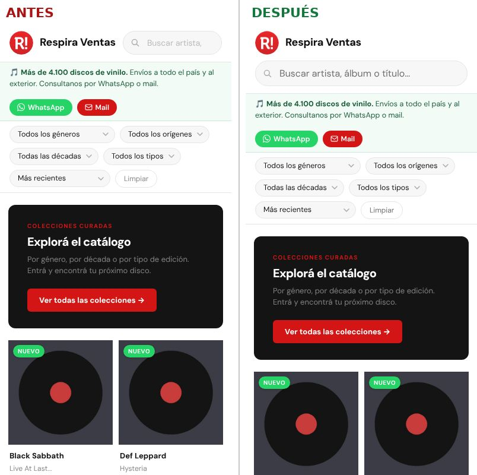
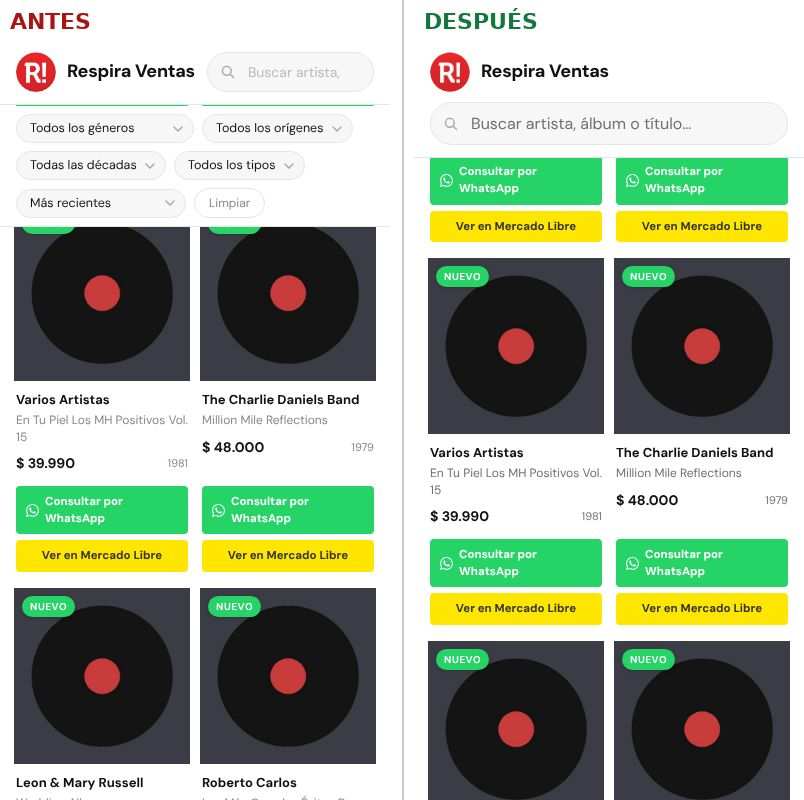
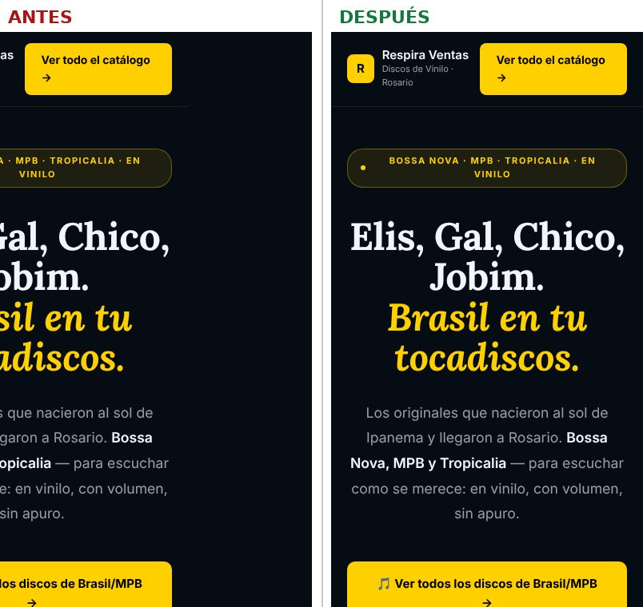
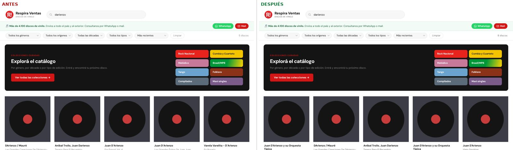
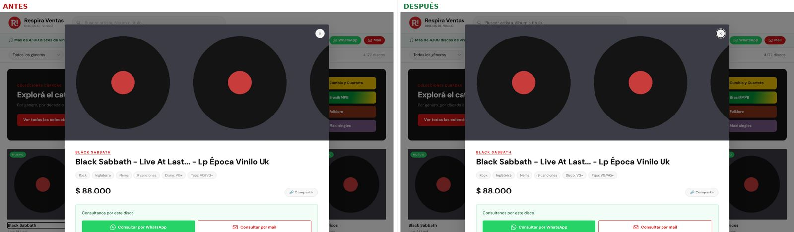
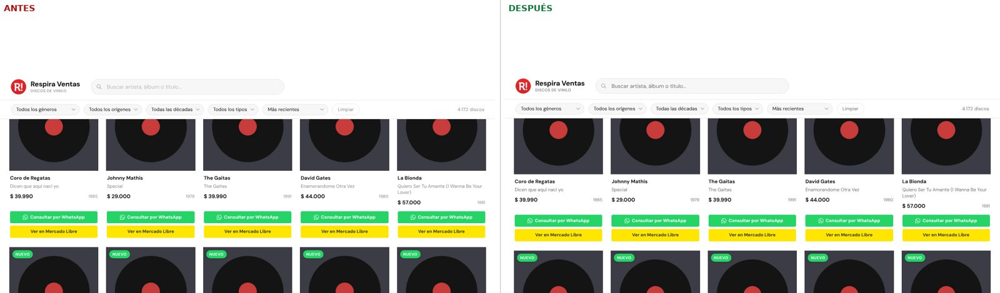

# Auditoría de funcionamiento, celular, velocidad y accesibilidad

Fecha: 3 de noviembre de 2026. Rama: `claude/nifty-mccarthy-o3bpz9`.

## Cómo se probó

- El sitio se sirvió localmente con compresión gzip, igual que GitHub Pages,
  y se recorrió con Chromium sin interfaz (Playwright).
- Se compararon dos copias: la de `main` (antes) y la de esta rama (después).
- Páginas revisadas: `index.html`, `colecciones.html`, `compilados.html`,
  `maxis.html`, las seis landings de género, `decada/1970.html`, `404.html`,
  tres fichas de `disco/` (una vendida, una de título muy largo y una con
  muchas fotos) y tres de `artista/` (una con muchos discos, otra con pocos y
  una sin discos).
- Anchos: 360, 390, 768 y 1280 px, más 375, 414, 430, 520, 600 y 700 px en
  las landings que se desbordaban.
- Accesibilidad: [axe-core](https://github.com/dequelabs/axe-core) con las
  reglas WCAG 2 A/AA, más recorrido con teclado y medición de zonas táctiles.
- Velocidad: celular simulado con la CPU 4 veces más lenta y red 4G lenta
  (1,6 Mbps, 150 ms).
- **Limitación:** desde este entorno no se puede acceder a las fotos de
  Mercado Libre (`http2.mlstatic.com`). Se reemplazaron por una imagen de
  prueba, así que lo que se compara es **cuántas** tapas se piden, no cuánto
  pesa cada una.
- No se tocó `data/`, `disco/`, `artista/`, `decada/`, `d/` ni los sitemaps.

## Resultados, de mayor a menor impacto

| # | Problema | Dónde | Estado |
|---|----------|-------|--------|
| 1 | En el celular, el encabezado y los filtros quedaban fijos y tapaban **224 px de 800** (28 % de la pantalla) mientras se miraban los discos | Portada | ✅ Corregido: quedan 118 px fijos, con el buscador completo |
| 2 | El buscador en el celular medía ~130 px: se leía "Buscar art" | Portada | ✅ Corregido: pasa a su propio renglón a todo el ancho |
| 3 | Brasil, Tango y Folklore **se corrían de costado** en el celular (la página medía 480-545 px en una pantalla de 360-390) | 3 landings | ✅ Corregido entre 360 y 768 px; a 1280 px quedan idénticas pixel a pixel |
| 4 | Se pedían **las 60 tapas** apenas se abría la portada, aunque en el celular se ven 4 | Portada | ✅ Corregido: 18 a 360 px y 45 a 1280 px; el resto se pide al bajar |
| 5 | La búsqueda no toleraba signos: "darienzo" daba 5 resultados y no 8 (faltaban los "D'Arienzo"), "bb muñoz" no encontraba "B.B. Muñoz", "uh huh" no encontraba "Uh-Huh". El apóstrofo curvo (’) que pone el celular también fallaba | Portada | ✅ Corregido |
| 6 | La ventana del disco no se podía usar con teclado: el foco quedaba detrás, Tab recorría la grilla de atrás y los "Discos relacionados" no se podían alcanzar | Portada | ✅ Corregido |
| 7 | Textos grises con contraste 3,5:1 (el mínimo para leer es 4,5:1); texto de ayuda del buscador a 1,9:1 | Portada, fichas, artistas, décadas, colecciones, 404 | ✅ Corregido (gris #888 → #707070) |
| 8 | Notas y pies de las landings con contraste de 2,5:1 a 3:1 | 6 landings | ✅ Corregido (se subió lo justo para llegar a 4,5:1) |
| 9 | Los cinco desplegables de filtros no tenían nombre para lectores de pantalla (decían solo "cuadro combinado") | Portada | ✅ Corregido |
| 10 | El archivo de discos (~700 KB) empezaba a bajar recién cuando terminaban los estilos y la fuente | Portada | ✅ Corregido con `preload`: los primeros discos aparecen ~0,5 s antes |
| 11 | El ícono del logo pesaba 33 KB (510×510 px para mostrarse a 40 px) y lo baja **cada página** del sitio | Todo el sitio | ✅ Corregido: 8 KB, misma imagen |
| 12 | Dos cambios de filtro seguidos dibujaban dos tandas (120 discos en vez de 60) | Portada | ✅ Corregido |
| 13 | Links chicos para el dedo (16-20 px de alto): artista y álbum de cada tarjeta, migas de pan y pie de las fichas | Portada y páginas generadas | ✅ Corregido sin cambiar cómo se ven |
| 14 | El botón "Cargar más discos" quedaba pegado a la izquierda | Portada | ✅ Corregido |
| 15 | "1 discos" | Portada | ✅ Corregido: "1 disco" |
| 16 | Enter en el buscador no hacía nada y el teclado del celular seguía tapando los resultados | Portada | ✅ Corregido |
| 17 | En el iPhone, tocar el buscador hacía zoom en la página (letra menor a 16 px) | Portada | ✅ Corregido solo en el buscador (ver pendiente 8) |
| 18 | Al recorrer con Tab, el elemento con foco podía quedar escondido debajo del encabezado fijo | Portada | ✅ Corregido |

### Direcciones con parámetros (probadas, sin errores)

`?q=` vacío, con espacios, con `%`, con `<script>`, con caracteres mal
codificados; `?genero=rock` (en minúscula), `?genero=noexiste`,
`?decada=1975`, `?decada=abc`, `?orden=xyz`, `?tipo=maxi singles`,
`?artista=` existente e inexistente, `?id=abc`, `?id=999`, `?id=` válido y
combinaciones. Ninguna rompe la página ni deja errores en la consola. Los
valores inválidos se ignoran y se quitan de la dirección.

Cambio de comportamiento a tener en cuenta: una búsqueda que es **solo
signos** (`%`, `###`) ahora muestra todo el catálogo, porque los signos no
cuentan para buscar. Antes mostraba "No se encontraron discos".

## Mediciones antes y después

| Medición | Antes | Después |
|----------|------:|--------:|
| Tapas pedidas al abrir la portada, celular 360 px | 60 | 18 |
| Tapas pedidas al abrir la portada, 1280 px | 60 | 45 |
| Tapas pedidas al abrir, celular con 4G lenta | 60 | 10 |
| Primeros discos en pantalla, celular simulado (mediana de 3) | 5,2 s | 4,75 s |
| Preparar el catálogo al abrir, CPU 4× más lenta | ~31 ms | ~13 ms |
| Peso propio de cada ficha, artista o década (sin fotos) | ~104 KB | ~79 KB |
| Ancho real de Brasil / Tango / Folklore en pantalla de 360 px | 530 / 480 / 530 px | 360 px |
| Alto tapado por encabezado + filtros al bajar, celular | 224 px | 118 px |
| Problemas de accesibilidad (axe) en la portada, 1280 px | 259 | 125 (todos de colores de marca: ver pendiente 4) |
| Problemas de accesibilidad (axe) en fichas, artistas y décadas | 22 a 129 por página | 0 a 1 por página |

## Capturas

| | |
|---|---|
| Celular, al abrir |  |
| Celular, al bajar |  |
| Brasil en el celular (la página se corría hacia la derecha) |  |
| Búsqueda "darienzo": 5 → 8 discos |  |
| Ventana del disco abierta con teclado: el foco pasa al botón de cerrar |  |
| Botón "Cargar más discos" |  |

La carpeta `auditoria-ux/` (~470 KB) solo existe para mostrar estas capturas.
Como el sitio publica todo el repositorio, se puede borrar antes o después
de mergear sin afectar nada.

## Lo que quedó sin resolver

Ordenado por impacto.

1. **El catálogo completo se baja en la portada: 6 MB (~700 KB comprimido).**
   Es lo que más tarda en el celular (unos 3,5 s de los 4,75 s). Está
   formateado con sangrías (sin ellas serían 4,4 MB) y cada disco trae la
   descripción completa y todas las fotos, que solo se usan al abrir la
   ventana del disco. Lo genera `actualizar.ps1`, que no se tocó porque
   produce archivos de datos y no se puede probar acá (no hay PowerShell).
   Propuesta para la sesión de datos: (a) escribir el JSON compacto
   (`ConvertTo-Json -Compress`); (b) separar un índice liviano (título,
   artista, álbum, precio, primera foto, ficha, género, origen, año, tipos)
   de un segundo archivo con descripciones y fotos extra, que se pida al abrir
   un disco.
2. **La landing de Melódico baja el catálogo entero (~700 KB) solo para
   mostrar un número** ("771 discos en catálogo"). Propuesta: que
   `actualizar.ps1` actualice ese número como ya hace con los totales de las
   otras landings, y quitar el `fetch` de la página.
3. **Las tapas se piden en tamaño completo** (`-F.jpg`) aunque se muestran a
   ~160 px. Mercado Libre suele ofrecer versiones más chicas cambiando el
   final del nombre, pero no se pudo verificar desde acá. Vale la pena probar
   en un navegador común si, por ejemplo, `-O.jpg` o `-V.jpg` existen y se
   ven bien; sería el mayor ahorro de datos del sitio.
4. **Colores de marca con poco contraste**, que no se cambiaron por ser parte
   de la identidad:
   - Botones verdes de WhatsApp y cartel "Nuevo": texto blanco sobre
     `#25d366` da 2:1.
   - Chips de colecciones con texto blanco sobre colores claros: Melódico
     (3,6:1), Tango (3:1); en `colecciones.html`, Cumbia y Cuarteto (1,9:1).
   - Rojo de rock nacional (`#E8231E`) con texto blanco: 4,47:1, apenas por
     debajo.
   - Números y títulos de color en las landings: Folklore `#8b3218` sobre
     oscuro (2,3:1), Tango celeste (2,6:1), "olas" de Brasil (1,6:1,
     decorativo).

   Una opción que conserva la identidad es oscurecer apenas el verde de los
   botones (por ejemplo `#15803d` da 5:1 con texto blanco). Es una decisión
   del dueño.
5. **La portada no tiene un título principal (`<h1>`).** Afecta a lectores
   de pantalla y a buscadores. Se deja para la sesión de SEO, que trabaja
   sobre los textos de la portada.
6. **Fuentes de Google bloquean el primer dibujo** de cada página y cada
   landing usa una fuente distinta (100-150 KB). Se podrían servir desde el
   propio sitio; requiere sumar archivos de fuentes y probar en varios
   navegadores.
7. **Cada tarjeta tiene 5 paradas de Tab** (foto, artista, álbum, WhatsApp,
   Mercado Libre) y las tres primeras llevan al mismo lugar. Se podría dejar
   una sola, pero cambia cómo se anuncia la tarjeta y conviene probarlo con
   un lector de pantalla real.
8. **Zoom del iPhone al tocar los desplegables de filtros**: tienen letra de
   12,5 px. Subirlos a 16 px en el celular los agranda y suma un renglón de
   filtros; no se hizo para no cambiar el aspecto.
9. **Plantillas de las páginas generadas** (`generar-fichas.ps1`,
   `generar-hubs.ps1`): detalles menores que no se tocaron porque cambiarían
   ~5.700 archivos en la próxima actualización y no se pueden probar acá:
   - Las migas de pan (`<nav class="f-breadcrumb">`) no tienen nombre
     (`aria-label="Migas de pan"`).
   - En la ficha, a 360 px "Respira Ventas" se parte en dos renglones
     (cosmético).
   - Las fichas piden `ficha.css?v=4`. No se cambió el número: GitHub Pages
     guarda copia 10 minutos, así que los cambios de `ficha.css` se ven solos
     en ese plazo.
10. **`?artista=` con un nombre inexistente** muestra "Mostrando no existe
    xyz" y cero discos. Funciona, pero el texto podría decir que no se
    encontró el artista.
11. **Copia del catálogo:** con el `preload`, un visitante que recarga la
    portada dentro de los 10 minutos puede ver el catálogo de hasta 10 minutos
    antes, igual que ya pasa con la página y `app.js`. Antes el catálogo se
    revalidaba siempre.

## Archivos tocados

- `app.js`: búsqueda, filtros, tarjetas, ventana del disco.
- `style.css`, `ficha.css`: contraste, celular, zonas táctiles.
- `index.html`: etiquetas de accesibilidad, `preload`, versión de los
  archivos. No se tocaron las marcas `ENVIOS:INICIO/FIN` ni el texto
  "Más de N discos", que actualizan los programas de `_PABLO`.
- Landings (`brasil`, `tango`, `folklore`, `melodico`, `cumbia-cuarteto`,
  `rock-nacional`): solo CSS. No se tocaron los totales que actualiza
  `actualizar.ps1`.
- `404.html`: un color.
- `assets/logo-icon.jpg`: misma imagen, más chica.
